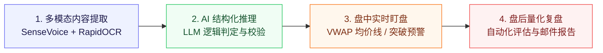

# 📈 app-stock-agent

[](https://python.org)
[](https://fastapi.tiangolo.com)
[](https://react.dev)
[](https://creativecommons.org/licenses/by-nc-nd/4.0/)

> **app-stock-agent** 是基于大语言模型与多智能体协同的股票行情监控、多模态内容分析与策略推理系统。

---

## 🌟 系统核心链路



1. **多模态内容提取** —— 定时追踪公开投资分析动态，结合本地 SenseVoice 语音转写与 RapidOCR 画面关键指标提取，完成行情多证据交叉核验。
2. **AI 结构化推理** —— 基于大语言模型进行条件提取、买卖逻辑判定与真实行情二次校验，规避虚假信号。
3. **盘中实时盯盘** —— 盘中定时按预设条件与分时均价线（VWAP）进行监控，出现破位或触发信号即刻生成预警。
4. **盘后量化复盘** —— 收盘后自动化评估关注标的是否兑现分析预期，输出结构化复盘结论与邮件提醒。

---

## 🛠️ 技术栈与架构

| 模块 | 核心技术栈 |
|---|---|
| **后端服务** | Python 3.12+ · FastAPI · SQLAlchemy (Async) · Pydantic v2 |
| **数据存储** | SQLite / PostgreSQL 支持 |
| **量化行情** | AKShare · 实时行情源解析 |
| **AI 推理与多模态** | 大语言模型结构化推理 · 本地 SenseVoice ASR · RapidOCR |
| **任务调度** | APScheduler 定时监控引擎 |
| **前端交互** | Vite · React 19 · Ant Design · ECharts 可视化仪表盘 |
| **容器化交付** | Docker · Docker Compose |

---

## ✨ 核心功能模块

- **智能数据流管道 (`stockagent/analysis/pipeline.py`)**：抓取 $\rightarrow$ 过滤 $\rightarrow$ LLM 条件提取 $\rightarrow$ 行情多证据消歧 $\rightarrow$ 存库。
- **盘中条件引擎 (`stockagent/engine/matcher.py`)**：实时匹配价格与量能条件，支撑盘中突破与破位预警。
- **离场监控 (`stockagent/engine/exit_monitor.py`)**：跟踪止盈止损策略与离场信号。
- **邮件通知与队列 (`stockagent/notification/email_notifier.py`)**：指数退避重试机制与死信队列保障。
- **Web 可视化面板 (`stockagent/web/`)**：基于 FastAPI 与 React 19 构建的多端交互式监控大屏。

---

## 🚀 快速上手

### 1. 环境准备
```bash
cp .env.example .env
# 编辑 .env 配置必要的环境变量（API Key、邮件服务等）
```

### 2. 本地运行
```bash
python3 -m venv .venv
source .venv/bin/activate
pip install -r requirements.txt
./run_dev.sh
```

### 3. Docker 部署
```bash
docker compose up -d
```

---

## 📄 知识产权与开源协议

本项目遵循 **[Creative Commons Attribution-NonCommercial-NoDerivatives 4.0 International (CC BY-NC-ND 4.0)](https://creativecommons.org/licenses/by-nc-nd/4.0/)** 严格非商业开源许可：

- ❌ **严禁商用**：任何个人或组织不得将本项目源码、编译产物或衍生版本用于任何商业盈利目的。
- ❌ **禁止演绎与分发修改版**：未经授权不得散布基于本项目修改后的二次分发版本。
- 🔒 **权利保留**：作者保留对本平台代码与架构的所有版权与法律追责权利。
